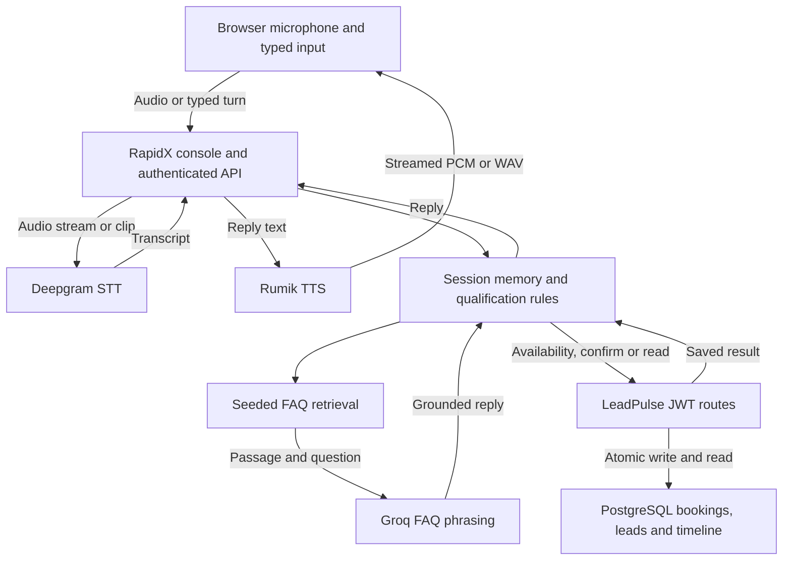
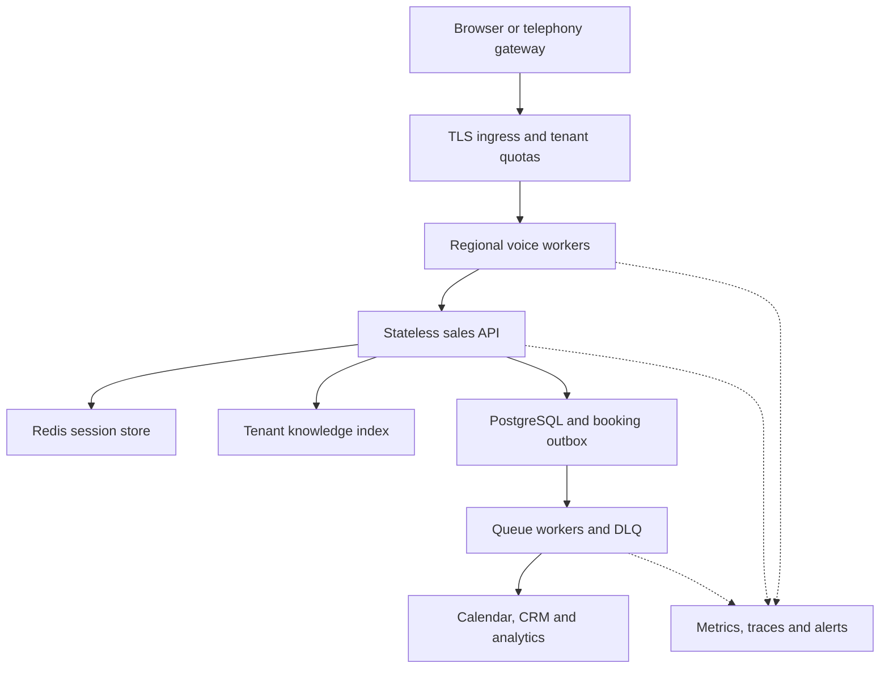

# FlowDesk architecture

Open [architecture.html](../rapidx/dashboard/public/architecture.html) from the source folder or at [localhost:8787/architecture.html](http://localhost:8787/architecture.html). Both diagrams are included as offline rendered SVGs. The Mermaid below is the editable source.

## Submitted prototype

FlowDesk uses Redis by default for sales sessions, with a memory-only local option. Sessions expire after 30 minutes of inactivity, with a cap of 24 conversational turns and four unsaved sessions per signed-in account. Refresh reopens an active session while Redis and the browser login remain available. The last saved CRM record is read through LeadPulse. LeadPulse uses Prisma and a single PostgreSQL transaction. `SalesRun.id` is the idempotency key. `SalesRun.slotId` is unique. RapidX sends the original session ID on retry. Redis also supports existing LeadPulse modules. The demo's booking write is synchronous and does not use the queue.

## Proposed production deployment

### Capacity targets for 100,000 registered accounts

Assume 10,000 monthly active accounts, two calls per account per 30-day month and three minutes per call. That is **20,000 calls and 60,000 connected voice minutes per month**. If 15% of the average day's calls land in its busiest hour, that is 100 starts per hour and about **five concurrent sessions** at a three-minute mean. A 10× launch or replay burst gives a **50-session** planning target. Before rollout, test 50 concurrent sessions and 100 for short headroom tests using synthetic speech and provider sandboxes. These are estimates and test targets.

- **Edge and workers** · Keep voice workers near media providers. Scale by active streams, CPU and pending starts. Apply admission and tenant limits before opening paid provider streams. Track queue age, time to first audio, turn latency, and provider errors separately. Use provider pools, circuit breakers and explicit fallback messages. Never silently switch language or store audio to recover an outage.
- **Stateless decisions** · Store versioned session state with a per-call lock in Redis, bounded turn history and an expiry. Verify recovery across a rolling deploy and avoid double-running a turn with request IDs. Use a durable opt-in customer profile with tenant-scoped lookup and editing for longer-term memory.
- **Data and async work** · Index tenant/history time and availability. Use pooled PostgreSQL connections, unique booking constraints, cursor pagination and read replicas for analytics. Put calendar sync, CRM webhooks, retention and aggregate refresh behind a transactional outbox. Check webhook signatures and idempotency keys, retry with backoff, and review the dead-letter queue.
- **Isolation** · Authenticate tenants and agents at ingress, scope application queries, enforce database RLS for production tenants, separate service permissions, and encrypt short-lived caches and persisted records. Verify two tenants cannot read or book on each other's schedules.
- **Load tests** · Ramp traffic and simulate slow providers, quota limits, two confirms for one slot, retries and worker loss. Capture p95 latency, error rate, pool wait, token/audio spend and duplicate bookings. Initial goals are p95 under 2.5 seconds from completed turn to first audio on streaming, fewer than 1% unexpected failures, and zero duplicate bookings.
